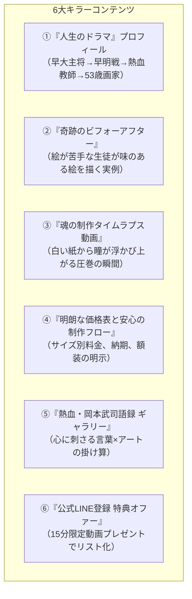
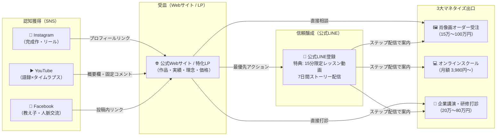

# 岡本武司（瑞司／おかもっちゃん）ウェブサイト構築提案書

---

## 1. 岡本武司氏におけるWebサイトの役割とゴール

岡本武司氏の事業展開において、Webサイトは単なる「会社案内」や「作品置き場」ではありません。  
**「SNSで惹きつけられた熱狂的なファンを、高単価オーダー・月額スクール・企業講演へと確実に繋ぐ【集客・成約の自動ハブ】」**として機能させる必要があります。

### Webサイトが果たすべき4大ミッション
1. **信頼と感動の獲得**：早大競走部主将→早明戦ラガーマン→熱血名監督→53歳独学画家という劇的な生き様を伝え、唯一無二の存在としてポジショニングする。
2. **注文・依頼のハードル低減**：「どこに頼めばいいか分からない」「いくらか分からない」を解消し、肖像画・企業講演・教室への明確な申込み口を明示する。
3. **リスト（見込み客）の自動獲得**：すべての訪問者を公式LINE／メルマガへ誘導し、一度の訪問で終わらせない「継続的な接点」を作る。
4. **運営負荷の最小化**：岡本氏本人が創作や指導、講演に集中できるよう、予約受付・決済・動画提供をできる限り自動化する。

---

## 2. 目的・フェーズ別 4つのWebサイト設計案

| 案 | サイトタイプ | 主な目的 | メインターゲット | 推奨CMS/ツール | 構築難易度 |
| :--- | :--- | :--- | :--- | :--- | :---: |
| **【案A】** | **総合ブランド＆ハブ型ポータル** | 全体像提示・社会的信用・総合窓口 | 教え子、法人、メディア、アートファン | STUDIO / WordPress | 中 |
| **【案B】** | **即効キャッシュ化・高単価LP特化型** | 肖像画受注＆企業講演の即時成約 | OB会、スポーツ界、企業経営者 | STUDIO / ペライチ | 低（最速） |
| **【案C】** | **オンラインアカデミー＆会員制プラットフォーム** | 月額安定収益（サブスク教室・サロン） | 50〜70代シニア、全国の絵画学習者 | Teachable / Kajabi + LP | 中〜高 |
| **【案D】** | **作家ギャラリー＆越境EC・体験予約サイト** | 物販（画材・グッズ）・海外/インバウンド | SNSフォロワー、台湾ファン、訪日外国人 | Shopify / BASE | 中 |

---

### 【案A】総合ブランド＆ハブ型ポータルサイト（All-in-One Brand Portal）

> **「おかもっちゃん／鉛筆画家 瑞司のすべてが集まる公式母艦」**

#### ① コンセプトと狙い
岡本氏の多面的な魅力（体育会魂×教育力×芸術性）を美しく整理し、個人のファンから企業の人事担当者、メディア関係者まで、誰が来ても迷わず目的の情報にたどり着ける公式オフィシャルサイト。

#### ② サイト構造・ページマップ
```
[TOPページ]
  ├── [プロフィール] ─ 挫折と挑戦の軌跡（早大・教師・53歳の転機・岡本語録）
  ├── [作品ギャラリー] ─ 鉛筆肖像画 / 風景画 / パステル彩画 / 過去の代表作
  ├── [オーダー制作] ─ メモリアル肖像画 / 経営者ルーツ画（料金表・制作の流れ）
  ├── [鉛筆画教室] ─ 「瑞司わくわく鉛筆画教室」（オンライン校 / 対面WS案内）
  ├── [企業・団体向け] ─ 講演・研修のご案内（テーマ・実績・登壇費用・動画）
  ├── [メディア・お知らせ] ─ 個展情報、テレビ/新聞掲載、ブログ、YouTube更新
  └── [お問い合わせ / LINE] ─ 制作相談フォーム / 公式LINE友だち追加
```

#### ③ デザインテイスト
- **カラー**：落ち着いた濃紺（早稲田・信頼感）× 清潔なホワイト × 温かみのあるオレンジ（情熱・Happy）
- **ビジュアル**：岡本氏の満面の笑顔、真剣な眼差しで描く制作風景、ダイナミックな原画の高解像度写真

#### ④ メリット・デメリット
- ⭕ **メリット**：社会的信用が最も高く、法人・教育機関・メディアからの依頼が急増する。
- ❌ **デメリット**：ページ数が多く、初期制作に1〜2ヶ月程度の工数と準備が必要。

---

### 【案B】即効キャッシュ化・高単価LP特化型（High-Ticket Conversion LP）

> **「迷わせない！『肖像画オーダー』と『熱血講演依頼』を最速で獲得する1枚完結LP」**

#### ① コンセプトと狙い
複雑なメニューをあえて排除し、高単価で即効性の高い**「① メモリアル肖像画の注文」**と**「② 企業のモチベーション講演・研修の打診」**に特化した縦長ランディングページ。

#### ② 構成ワイヤーフレーム（上から下へのストーリー設計）
```
1. ファーストビュー：強烈なキャッチコピー ＋ 肖像画のドアップ ＋ 岡本氏の笑顔
   「53歳、未経験からプロへ。言葉を超える鉛筆画と、魂を揺さぶる挑戦の物語」
2. 共感・問題提起：
   「大切な人の節目に、一生色褪せない感動を贈りたい」「組織の挑戦意欲に火をつけたい」
3. 2大サービスの提示（明確なタブ切り替え）：
   【Service 1】魂のメモリアル肖像画（スポーツ引退・創業者・記念品）
   【Service 2】熱血企業講演『遅すぎる挑戦などない：常識打破の技術』
4. 圧倒的な実績・作例・教え子/クライアントの声：
   ・早大早明戦・箱根駅伝OBからの声
   ・講演を受講した企業幹部の感想アンケート
5. 明確な料金体系・制作/登壇までのステップ（不安の解消）
6. 無料相談・お見積りCTA（公式LINEまたは簡易フォーム）
```

#### ③ メリット・デメリット
- ⭕ **メリット**：制作期間1〜2週間でスピード公開可能。広告やSNSからの直リンクで即売上に直結。
- ❌ **デメリット**：教室やグッズ販売など、多角的な情報を網羅するには不向き。

---

### 【案C】オンラインアカデミー＆会員制プラットフォーム（Subscription & Community Hub）

> **「誰でも描ける！おかもっちゃんの瑞司式わくわく鉛筆画オンライン校」**

#### ① コンセプトと狙い
月額3,980円〜9,800円の継続課金（ストック収益）を柱とする、オンライン動画講座と受講生コミュニティを一体化したWebプラットフォーム。

#### ② サイト構造
- **フロント（公開LP）**：
  - 「絵心ゼロでも大丈夫！鉛筆1本で始める大人のワクワク体験」
  - 初心者ビフォーアフター（生徒が15分で描いたリンゴや似顔絵）
  - 無料動画レッスンプレゼント（LINE登録への誘導）
  - 入会プラン案内（月額制・コミュニティ付き）
- **バックエンド（会員限定マイページ）**：
  - レベル別レッスン動画ライブラリ（基礎編、人物編、風景編）
  - 月1回Zoomライブ配信の受講リンク
  - 「今月の添削コーナー」（受講生がスマホで撮った写真をアップロード）
  - 受講生同士が作品を見せ合い褒め合う「わくわく掲示板」

#### ③ 推奨ツール選定
- **パターン1（海外製オールインワン）**：`Teachable` または `Kajabi`（動画配信、決済、受講管理がすべて完結）
- **パターン2（国内プラットフォーム連携）**：`STUDIO（紹介LP）` ＋ `DMMオンラインサロン` または `MOSH / クラスペディア`

#### ④ メリット・デメリット
- ⭕ **メリット**：会員が増えるほど自動的に収益が積み上がり、岡本氏の労働時間を切り売りせずに済む。
- ❌ **デメリット**：動画教材の事前撮影・編集、月次のコミュニティ運営が必要。

---

### 【案D】作家ギャラリー＆越境EC・体験予約サイト（Art Gallery & Global EC）

> **「原画・厳選画材・カレンダー販売 ＆ 訪日・海外向けワークショップ予約」**

#### ① コンセプトと狙い
岡本氏が厳選した「スターターキット」や「日めくり元気カレンダー」、高品質複製原画（ジークレー）を自動販売し、さらに台湾ファンやインバウンド訪日客向けの「鉛筆画リアル体験」を予約決済できる多言語ECサイト。

#### ② 主要機能・ページ
- **Online Shop**：
  - 瑞司監修「はじめての鉛筆画スターターキット」（特選鉛筆、消しゴム、紙、動画解説QR付）
  - おかもっちゃん日めくりカレンダー（岡本武司語録入り）
  - 数量限定・直筆サイン入り複製原画（額装付き）
- **Workshop Booking（多言語：日・英・繁体字）**：
  - 「Japanese Soul 鉛筆画体験（2時間プライベート/グループ）」カレンダー予約・事前決済
- **Gallery / Exhibition**：
  - 国内・台湾での過去個展アーカイブ、今後の展示スケジュール

#### ③ 推奨ツール
- **国内中心の場合**：`BASE` または `STORES`（開設が簡単、手数料が安価）
- **海外・多言語展開を視野に入れる場合**：`Shopify`（多通貨決済、自動翻訳、海外配送対応に強み）

---

## 3. Webサイトに必ず組み込むべき「6大キラーコンテンツ」

どの案を採用する場合でも、岡本氏の強みをマネタイズに直結させるために必須のコンテンツです。



---

## 4. SNS × Webサイト × 公式LINEの統合導線設計

岡本氏が最もやりたい「SNS等デジタルメディアからの導線作り」の完成形です。



---

## 5. 推奨する「段階的導入ロードマップ」

予算や運営の手間を抑えつつ、最速で成果を出すためのステップ提案です。

```
【ステップ1：今すぐ（1〜2ヶ月目）】
  ★ 案B「即効キャッシュ化LP」＋「公式LINE構築」
  ・まずは1枚の美しい縦長LPで、肖像画受注・講演受付・LINE登録窓口を開設。
  ・SNSのリンク先をここに統一し、すぐに売上と見込み客リストを作る。
      ▼
【ステップ2：基盤構築（3〜5ヶ月目）】
  ★ 案C「オンラインスクール」または「ファンクラブ」のプレオープン
  ・LINE登録者に向けて、月額制の鉛筆画教室やコミュニティを案内し、継続収入の柱を構築。
      ▼
【ステップ3：ブランド完成（6ヶ月目以降）】
  ★ 案A「総合ブランドポータル」へ統合拡張 ＋ 案D「公式EC」
  ・全体のハブとなるオフィシャルサイトを完成させ、画材キットやカレンダーの自動物販、海外インバウンド受付を開始。
```

---

## 6. まとめ：制作ツールの推奨組み合わせ

| 用途 | 推奨ツール | 選定理由 |
| :--- | :--- | :--- |
| **Webサイト / LP** | **STUDIO (スタジオ)** | ノーコードでプロ品質のデザインが可能。保守・更新が極めて簡単で、サーバー管理不要。 |
| **見込み客育成** | **公式LINE (Lステップ等)** | シニア層も日常的に使っており、メルマガより開封率が5〜10倍高い。ステップ配信が自動化可能。 |
| **物販・決済** | **BASE または Shopify** | 初期費用無料で即日ネットショップを開設可能。カード決済やコンビニ決済にも標準対応。 |
| **動画講座配信** | **MOSH または Vimeo + 限定ページ** | 日本語対応でシニアにも使いやすく、月額サブスク課金の自動管理が容易。 |
