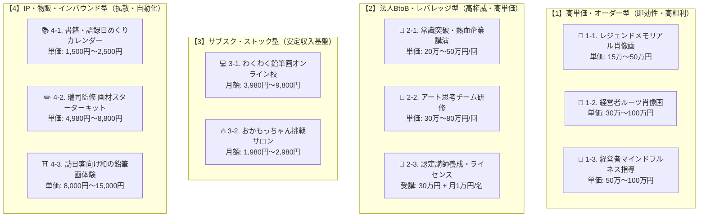
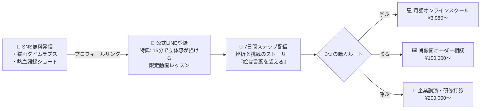
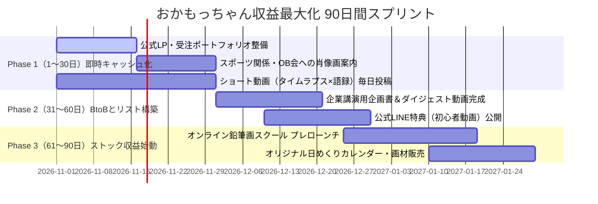

# 🎨 岡本武司（おかもっちゃん）ビジネスアイデア・ビジュアルカタログ＆収益ダッシュボード

> **「絵は言葉を超える。ワクワクに年齢は関係ない」**  
> 唯一無二の強み（早大競走部主将＆早明戦ラガーマン × 熱血名監督の教育力 × 53歳独学画家）を最大マネタイズする、直感型ビジュアルカタログ＆収益設計書。

---

## 📊 1. 収益ポートフォリオ・全体ダッシュボード

### ① 4象限ポジショニングマップ（単価 × レバレッジ）



---

### ② 目標収益シミュレーション（月商 250万円 / 年商 3,000万円モデル）

| 収益の柱 | 対象商品・サービス | 単価目安 | 想定販売数 | 月間売上 | 労働負荷 |
| :--- | :--- | :---: | :---: | :---: | :---: |
| **柱①：安定ストック** | オンライン鉛筆画教室 ＆ サロン | ¥4,980 /月 | 200名 | **約 100万円** | 🟢 低（月2回配信＋添削） |
| **柱②：法人・講演** | 企業講演 ＆ チーム研修 | ¥300,000 /回 | 月2回 | **約 60万円** | 🟡 中（登壇当日のみ） |
| **柱③：高付加価値原画** | メモリアル肖像画・経営者原画 | ¥250,000 /枚 | 月2枚 | **約 50万円** | 🔴 高（制作集中） |
| **柱④：物販・IP・体験** | 画材セット・書籍・インバウンド | ¥5,000〜¥15,000 | 計40件 | **約 40万円** | 🟢 極低（自動販売・外注） |
| **合計（月間）** | **4本柱のハイブリッド経営** | — | — | **🔥 250万円** | **年間 3,000万円** |

---

### ③ 集客から購入までの自動導線（ファネル設計）



---

## 🗂️ 2. ビジュアルカード型・ビジネスアイデア カタログ

---

### 💳 CARD 01：高単価オーダー
```
┌────────────────────────────────────────────────────────┐
│ 🏅 アスリート・名将向け「魂のメモリアル鉛筆肖像画」     │
├────────────────────────────────────────────────────────┤
│ [ターゲット] プロ/実業団/大学の引退選手・名監督・OB会    │
│ [想定単価]   15万円 〜 50万円 / 点                    │
│ [期待年商]   300万円 〜 600万円 (年15〜20点)          │
│ [即効性] ★★★★★  [収益性] ★★★★★  [レバレッジ] ★★☆☆☆ │
├────────────────────────────────────────────────────────┤
│ 💡 強みの掛け算:                                       │
│   早大競走部主将＆早明戦ラガーマンとしての「勝負の世界」 │
│   の理解。筋肉の躍動、戦う男の瞳の光を魂ごと描き切る。   │
│                                                        │
│ 🎯 アクション:                                         │
│   箱根駅伝・早明戦・高校部活の節目に合わせたOB会への   │
│   提案ポートフォリオ（過去作サンプル）を制作。         │
└────────────────────────────────────────────────────────┘
```

---

### 💳 CARD 02：高単価オーダー
```
┌────────────────────────────────────────────────────────┐
│ 🏢 経営者向け「人生の原点を刻む ルーツ・ポートレート」 │
├────────────────────────────────────────────────────────┤
│ [ターゲット] 中小企業オーナー、創業社長、事業承継創業者│
│ [想定単価]   30万円 〜 100万円 / 点                   │
│ [期待年商]   360万円 〜 800万円 (年8〜12点)           │
│ [即効性] ★★★★☆  [収益性] ★★★★★  [レバレッジ] ★★☆☆☆ │
├────────────────────────────────────────────────────────┤
│ 💡 強みの掛け算:                                       │
│   「言葉を超える表現力」。ただの似顔絵ではなく、創業時 │
│   の古い工場や原点の情景を背景に織り交ぜる叙情詩的アート│
│                                                        │
│ 🎯 アクション:                                         │
│   ロータリークラブ・商工会議所での個展・寄贈から紹介獲得│
└────────────────────────────────────────────────────────┘
```

---

### 💳 CARD 03：サブスク・ストック
```
┌────────────────────────────────────────────────────────┐
│ 💻 おかもっちゃんの瑞司式 わくわく鉛筆画オンライン校  │
├────────────────────────────────────────────────────────┤
│ [ターゲット] 50代〜70代の絵心がないと思い込むシニア層  │
│ [想定単価]   月額 3,980円 〜 9,800円                   │
│ [期待年商]   1,200万円 〜 1,800万円 (会員150〜200名)  │
│ [即効性] ★★★☆☆  [収益性] ★★★★★  [レバレッジ] ★★★★★ │
├────────────────────────────────────────────────────────┤
│ 💡 強みの掛け算:                                       │
│   「熱血高校教師のコーチング力」。誰でも簡単に描ける  │
│   ステップ配信と、受講生を肯定し自信を爆発させる声かけ│
│                                                        │
│ 🎯 仕組み:                                             │
│   月2本の基礎動画 ＋ 月1回Zoom生ライブ添削 ＋ 交流チャット│
└────────────────────────────────────────────────────────┘
```

---

### 💳 CARD 04：BtoB・講演事業
```
┌────────────────────────────────────────────────────────┐
│ 🎤 企業講演『遅すぎる挑戦などない：常識打破の熱血突破力』│
├────────────────────────────────────────────────────────┤
│ [ターゲット] 企業の社員総会、キックオフ、周年記念行事   │
│ [想定単価]   20万円 〜 50万円 / 回 (60〜90分)         │
│ [期待年商]   300万円 〜 600万円 (月1〜2回登壇)        │
│ [即効性] ★★★★☆  [収益性] ★★★★★  [レバレッジ] ★★★★☆ │
├────────────────────────────────────────────────────────┤
│ 💡 強みの掛け算:                                       │
│   陸上主将→ラグビー直談判→53歳で未経験から画家の生き様 │
│   そのものが「リスキリング」「挑戦する組織風土」の教材。│
│                                                        │
│ 🎯 アクション:                                         │
│   講演タイトル・実績・登壇ダイジェスト動画をまとめた   │
│   「講演専用Webページ（講師プロフィール）」の開設。   │
└────────────────────────────────────────────────────────┘
```

---

### 💳 CARD 05：BtoB・企業研修
```
┌────────────────────────────────────────────────────────┐
│ 🤝 アート思考×対話「心理的安全性を高める観察力研修」   │
├────────────────────────────────────────────────────────┤
│ [ターゲット] 企業の人事部、新任管理職、新入社員チーム  │
│ [想定単価]   30万円 〜 80万円 / 回 (半日〜1日)        │
│ [期待年商]   360万円 〜 600万円                       │
│ [即効性] ★★★☆☆  [収益性] ★★★★★  [レバレッジ] ★★★★☆ │
├────────────────────────────────────────────────────────┤
│ 💡 強みの掛け算:                                       │
│   「お互いの顔を描き合い、美点を発見する」ワークショップ│
│   元ラグビー部名監督だからできるチームビルディング指導。│
│                                                        │
│ 🎯 提供価値:                                           │
│   「固定観念を外して対象を見る」デッサンの基本をビジネス│
│   の傾聴・観察スキルへ転化。研修満足度が極めて高い。   │
└────────────────────────────────────────────────────────┘
```

---

### 💳 CARD 06：ライセンス・組織化
```
┌────────────────────────────────────────────────────────┐
│ 📜 瑞司式 鉛筆画ファシリテーター・認定講師制度         │
├────────────────────────────────────────────────────────┤
│ [ターゲット] 各地で絵画教室を開きたい受講生・元教え子  │
│ [想定単価]   養成講座 30万円 ＋ 月額更新料 1万円/人    │
│ [期待年商]   400万円 〜 800万円                       │
│ [即効性] ★★☆☆☆  [収益性] ★★★★★  [レバレッジ] ★★★★★ │
├────────────────────────────────────────────────────────┤
│ 💡 強みの掛け算:                                       │
│   岡本氏1人の稼働に依存しない全国・世界（台湾等）展開。│
│   教育者として「先生を育てる」という天職の発揮。       │
│                                                        │
│ 🎯 仕組み:                                             │
│   公式カリキュラムと指導マニュアルをパッケージ化。     │
│   認定校として看板を掲げられる権利と公式画材卸。       │
└────────────────────────────────────────────────────────┘
```

---

### 💳 CARD 07：ファンクラブ・コミュニティ
```
┌────────────────────────────────────────────────────────┐
│ 🔥 オンラインサロン「おかもっちゃん ワクワク挑戦倶楽部」│
├────────────────────────────────────────────────────────┤
│ [ターゲット] 元教え子、全国の熱狂的ファン、シニア挑戦者│
│ [想定単価]   月額 1,980円 〜 2,980円                   │
│ [期待年商]   400万円 〜 700万円 (会員200〜300名)      │
│ [即効性] ★★★☆☆  [収益性] ★★★★☆  [レバレッジ] ★★★★★ │
├────────────────────────────────────────────────────────┤
│ 💡 強みの掛け算:                                       │
│   教え子コミュニティの強固な絆と「岡本武司語録」の引力。│
│                                                        │
│ 🎯 提供コンテンツ:                                     │
│   ・毎朝の「おかもっちゃん熱血音声/名言配信」          │
│   ・月1回「オンラインおかもっちゃんBAR（飲み交流会）」 │
│   ・年1回「おかもっちゃん祭り（大同窓会＆リアル個展）」│
└────────────────────────────────────────────────────────┘
```

---

### 💳 CARD 08：IP・プロダクトEC
```
┌────────────────────────────────────────────────────────┐
│ ✏️ 瑞司監修「はじめての鉛筆画スターターキット」＆カレンダー│
├────────────────────────────────────────────────────────┤
│ [ターゲット] 初心者、SNSフォロワー、個展来場者         │
│ [想定単価]   キット 4,980円〜8,800円 / 日めくり 2,000円 │
│ [期待年商]   200万円 〜 400万円                       │
│ [即効性] ★★★★☆  [収益性] ★★★☆☆  [レバレッジ] ★★★★★ │
├────────────────────────────────────────────────────────┤
│ 💡 強みの掛け算:                                       │
│   「何を買えばいいか分からない」初心者に向け、おかもっ │
│   ちゃんが実際に使う厳選鉛筆・紙・消しゴムをセット化。 │
│                                                        │
│ 🎯 仕組み:                                             │
│   解説動画QRコード付き。BASE/Shopify等のECで自動発送。 │
└────────────────────────────────────────────────────────┘
```

---

### 💳 CARD 09：インバウンド＆海外展開
```
┌────────────────────────────────────────────────────────┐
│ ⛩️ 訪日外国人向け「Zen & Soul 鉛筆画ワークショップ」   │
├────────────────────────────────────────────────────────┤
│ [ターゲット] 京都・関西を訪れる訪日外国人観光客・台湾ファン│
│ [想定単価]   8,000円 〜 15,000円 / 人 (2時間)          │
│ [期待年商]   250万円 〜 500万円                       │
│ [即効性] ★★★☆☆  [収益性] ★★★★☆  [レバレッジ] ★★★☆☆ │
├────────────────────────────────────────────────────────┤
│ 💡 強みの掛け算:                                       │
│   「絵は言葉を超える」を地で行く国際親善コミュニケーション│
│   台湾での個展実績をベースにしたアジア圏での高い親和性。│
│                                                        │
│ 🎯 集客窓口:                                           │
│   Airbnb Experiences、Klook、Tripadvisorへの登録。     │
└────────────────────────────────────────────────────────┘
```

---

## ⚡ 3. 実行難易度 × 収益性 マトリクス一覧表

| アイデア名 | カテゴリ | 導入スピード | 粗利率 | 労働依存度 | 年商ポテンシャル | 推奨着手順 |
| :--- | :--- | :---: | :---: | :---: | :---: | :---: |
| **01. メモリアル肖像画** | フロー受注 | ⚡ 即日（今すぐ可） | 95% | 高（制作） | 300万〜600万円 | **第 1 位** |
| **04. 常識打破の企業講演** | BtoB法人 | ⚡ 1ヶ月（資料化） | 90% | 低（登壇のみ） | 300万〜600万円 | **第 2 位** |
| **03. オンライン鉛筆画スクール** | サブスク | ⏳ 2〜3ヶ月（準備） | 90% | 極低（配信） | 1,200万〜1,800万円 | **第 3 位** |
| **08. スターターキット＆物販** | 物販・EC | ⏳ 1〜2ヶ月（仕入れ） | 50% | 自動（発送代行） | 200万〜400万円 | **第 4 位** |
| **07. 挑戦サロン（ファンクラブ）** | サブスク | ⏳ 2ヶ月（告知） | 95% | 低（交流） | 400万〜700万円 | **第 5 位** |
| **02. 経営者ルーツ肖像画** | フロー受注 | ⏳ 2〜3ヶ月（開拓） | 95% | 高（制作） | 360万〜800万円 | **第 6 位** |
| **05. チームビルディング研修** | BtoB法人 | ⏳ 3ヶ月（営業） | 90% | 中（ワーク指導）| 360万〜600万円 | **第 7 位** |
| **06. 認定講師養成制度** | ライセンス | ⏳ 6ヶ月〜1年 | 95% | 極低（組織運営） | 400万〜800万円 | **第 8 位** |
| **09. インバウンド体験** | 体験・観光 | ⏳ 3〜4ヶ月（登録） | 85% | 中（現場対応） | 250万〜500万円 | **第 9 位** |

---

## 🚀 4. ロードマップ：収益ダッシュボードを起動する「90日アクション」



### 今すぐ着手すべき「最初の3アクション」
1. **作品・価格表をまとめた「公式ポートフォリオLP」の作成**（似顔絵・肖像画を迷わず注文できる窓口を作る）
2. **Instagram / YouTube ショートで「タイムラプス × 熱血語録」の毎日発信**（再生数とフォロワーの爆発的獲得）
3. **企業講演向け「講師プロフィールシート（A4 表裏 1枚）」のPDF化**（知人経営者や企業窓口へ直接提案）
