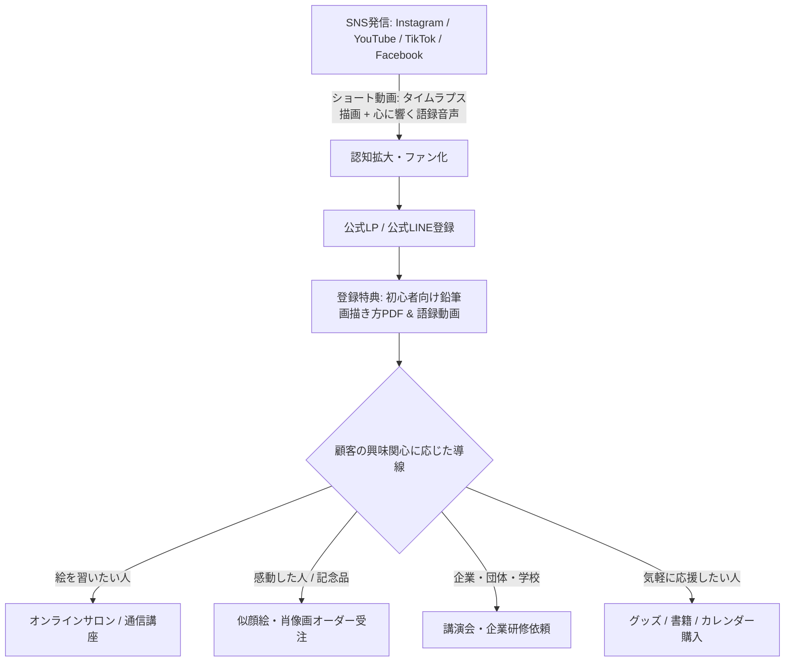

# 岡本武司（瑞司／おかもっちゃん）強み最大化＆経済的豊かさを実現するビジネスアイデア集

---

## はじめに：岡本武司氏の「唯一無二の掛け算（コア・アセット）」

岡本氏の最大の特徴は、一般的な「画家」や「元教師」の枠組みを大きく超えた、極めて稀有なキャリアの掛け算にあります。

```
【早大競走部主将 × ラグビー早明戦出場】（圧倒的な突破力・スポーツ界の人脈・勝負強さ）
　　×
【熱血高校体育教師・名監督】（人を育てるコーチング力・教え子コミュニティ・言葉の力）
　　×
【53歳から独学でプロへ転身した鉛筆画家】（シニア・大人の挑戦の希望・魂を写す表現力）
　　×
【「おかもっちゃん」の人間的魅力】（笑顔・オープンマインド・国内外を惹きつけるエネルギー）
```

この強力なアセットを**「BtoC（個人向け）」「BtoB（企業向け）」「ストック型（定額・継続収益）」「高単価オーダー（フロー型）」**に体系化し、経済的豊かさと社会的影響力を両立させる具体的なビジネスアイデアを提案します。

---

## カテゴリ1：高単価オーダー＆メモリアルアート事業（フロー型・高収益）

自らの技術と人脈、そして「人生のドラマを描く」ストーリーテリング力を活かした高単価アートビジネスです。

### 1-1. アスリート・名将向け「魂のメモリアル鉛筆肖像画」受注
* **概要**：プロ・実業団・大学・高校スポーツの引退記念、優勝記念、監督就任・退任記念などに贈る特注の大型鉛筆肖像画。
* **強みの活用**：箱根駅伝の総合優勝経験、早大ラグビー部での実績があるため、スポーツ関係者の心情、身体の躍動感、指導者の背負うプレッシャーを誰よりも深く理解して絵に昇華できる。
* **ターゲット**：大学・高校のOB会、実業団チーム、引退するプロ選手、後援会。
* **価格帯・収益性**：1点 15万円〜50万円（サイズ・額装・ストーリーブック付で高単価化）。年間20点受注で年商300万〜1,000万円。

### 1-2. 企業経営者・創業者向け「人生の原点を描く肖像画（ルーツ・ポートレート）」
* **概要**：中小企業オーナーや起業家の創業記念、叙勲祝い、事業承継・勇退記念として、経営者の顔とともに「創業当時の工場」や「人生を変えた瞬間」を背景に盛り込んだ記念画。
* **強みの活用**：「言葉を超える表現力」と温かみのあるタッチで、単なる写真模写ではない「生き様・人間味」を表現。
* **ターゲット**：ロータリークラブ、ライオンズクラブ、商工会議所、同友会の会員経営者。
* **価格帯・収益性**：1点 30万円〜100万円。経営者ネットワークからの紹介リピートが期待できる。

### 1-3. シニア向け「生前記念肖像画・家族の絆アート」
* **概要**：終活や金婚式、古希・米寿・白寿の記念に、本人の最高の笑顔や夫婦・孫との絆を鉛筆画として残すサービス。
* **強みの活用**：同世代（シニア層）の気持ちに寄り添い、対話を通じて自然な表情を引き出す力。
* **価格帯・収益性**：1点 5万円〜15万円（ギフト需要・子ども世代からのプレゼント需要を狙う）。

---

## カテゴリ2：教育・スクール＆ライセンス事業（レバレッジ型・ストック型）

「誰でも描ける」「ワクワクに年齢は関係ない」を仕組み化し、岡本氏の時間を切り売りせずに収益を拡大させるモデルです。

### 2-1. 「おかもっちゃんの瑞司式わくわく鉛筆画オンラインアカデミー」
* **概要**：完全未経験のシニア・社会人を対象とした月額制オンライン絵画スクール。
* **内容**：
  * 月2〜4本の動画講義（デッサンの基礎、顔の描き方、光と影の捉え方）
  * 月1回のZoomライブ講義＆グループ添削
  * 会員限定コミュニティ（受講者同士が作品を褒め合う安全な場）
* **強みの活用**：元教師ならではの分かりやすい指導法と、受講者の自己肯定感を爆発的に高めるコーチング力。
* **価格帯・収益性**：月額 3,980円〜9,800円。
  * 会員200名達成時：月商約100万〜150万円（年商1,200万〜1,800万円の安定収益基盤）。

### 2-2. 「瑞司式 鉛筆画ファシリテーター・認定講師養成講座」
* **概要**：「瑞司式わくわく鉛筆画」の指導法を学び、各地で子どもや高齢者向けにワークショップを開ける認定講師を育成。
* **仕組み**：
  * 3ヶ月〜6ヶ月の集中講座（受講料：20万〜30万円）
  * 認定試験合格後、支部として開講可能（ライセンス料・教材仕入れマージン：月額1万円または売上の10〜20%）
* **強みの活用**：台湾や全国への展開を自分一人で行うのではなく、弟子・仲間を増やすことで「瑞司ブランド」の全国・世界展開を実現。

### 2-3. 子ども向け「自己肯定感が爆発するアート＆情熱教室」
* **概要**：「絵の上手い下手ではなく、自分らしさを表現する」教育プログラム。夏休み・春休みの集中講座や、フリースクール・私立学校への特別授業。
* **強みの活用**：元高校教員としての教育的信用と、生徒のモチベーションに火をつける天性の才能。

---

## カテゴリ3：企業研修・講演・エグゼクティブ向け（BtoB・高単価）

岡本氏の真骨頂である「陸上主将 ➔ ラグビー早明戦 ➔ 熱血教師 ➔ 53歳からプロ画家」という劇的な人生体験は、現代の企業が最も求める「リスキリング」「挑戦する組織風土」「心理的安全性」「アート思考」に直結します。

### 3-1. 企業講演『遅すぎる挑戦などない：常識の枠を破る突破力と情熱の技術』
* **概要**：周年行事、全国大会、キックオフイベント、社員総会での基調講演。
* **テーマ**：
  * 誰もが無謀と言ったラグビー転身を可能にした「熱意と直談判の極意」
  * 53歳未経験からプロになった「思い込みの外し方」
  * 人を育てる「肯定の力（岡本武司語録の神髄）」
* **価格帯・収益性**：1回 60〜90分で 20万円〜50万円（著名人枠として定着すれば80万円以上も可能）。

### 3-2. 幹部・リーダー向け「アート思考×観察力・対話型チームビルディング研修」
* **概要**：鉛筆画の基礎技法（対象を固定観念なしでじっくり観察する力）を活用した企業研修。
* **内容**：
  * お互いの似顔絵を描き合うことで、相手の美点や個性を発見する「共感・心理的安全性ワーク」
  * 筆圧や濃淡のコントロールを通じた「自己統制・集中力」トレーニング
* **価格帯・収益性**：半日〜1日研修で 30万円〜80万円。

### 3-3. 経営者・エグゼクティブ専用「マインドフルネス鉛筆デッサン個人指導」
* **概要**：超多忙な経営者が雑念を消し、頭をクリアにするためのマンツーマン・プライベートセッション（絵画版パーソナルトレーニング）。
* **強みの活用**：体育会魂と芸術性を兼ね備えた岡本氏だからこそ、経営者の孤独やプレッシャーを受け止め、メンターとして機能できる。
* **価格帯・収益性**：月2回（各90分）× 6ヶ月契約で 50万円〜100万円。

---

## カテゴリ4：コミュニティ・ファンクラブビジネス（継続課金・共感型）

岡本氏の愛称「おかもっちゃん」と、多くの教え子（チルドレン）やファンの熱量を最大化するコミュニティ運営です。

### 4-1. オンラインファンコミュニティ「おかもっちゃんワクワク挑戦倶楽部」
* **概要**：年齢に関係なく新しい挑戦をしたい大人が集まるオンラインサロン。
* **提供価値**：
  * 毎朝届く「おかもっちゃんの元気が出る日めくり熱血メッセージ・語録」
  * 制作現場の裏側ライブ配信、新作の先行公開
  * メンバーの挑戦をみんなで応援する月例オンライン集会（おかもっちゃんBAR）
* **価格帯・収益性**：月額 1,500円〜3,000円。
  * 300名参加で月商45万〜90万円の安定した継続収入。

### 4-2. 年1回の「全国おかもっちゃん祭り（大個展＆同窓大交流会）」
* **概要**：教え子、ラグビー関係者、絵画教室受講生、SNSファンが一堂に会する大型フェス型個展。
* **収益ポイント**：
  * 入場料・懇親会参加費
  * 原画・限定版画の即売
  * オリジナルグッズ（Tシャツ、語録カレンダー、画集）の販売

---

## カテゴリ5：IP・出版・プロダクト＆デジタル物販（スケール型）

デジタル技術やECを活用し、岡本氏が寝ている間でも売上が発生する仕組みを構築します。

### 5-1. 書籍・電子書籍の出版（商業出版＆Kindle）
* **タイトル案**：
  * 『53歳、雷に打たれて画家になった男の「何歳からでも人生は変えられる」技術』
  * 『絵を描くだけで心が軽くなる：おかもっちゃん式わくわく鉛筆画メソッド』
  * 『人を動かす、自分を動かす：元早大主将・熱血教師が遺したい30の言葉（岡本武司語録）』
* **効果**：印税収入に加え、講演会や高単価オーダーの受注単価・信頼度を一気に押し上げるブランディング効果。

### 5-2. オリジナル画材・ブランド商品の開発・プロデュース
* **商品例**：
  * 「瑞司監修：はじめての鉛筆画スターターキット」（特選鉛筆、消しゴム、オリジナルスケッチブック、解説動画QRコード付き）
  * 「おかもっちゃん日めくり元気カレンダー」（絵＋語録の組み合わせ）
  * 高品質複製原画（ジークレー版画・直筆サイン＆シリアルナンバー入り：2万〜5万円）
* **販路**：公式オンラインショップ（BASE/Shopify）、個展会場、展示会。

### 5-3. 海外・インバウンド向け「Japanese Soul 鉛筆画体験ワークショップ」
* **概要**：すでに実績のある台湾をはじめ、欧米・アジアからの訪日外国人向けに「日本の心」「侍スピリット」「禅の集中」を鉛筆画で体感する体験アクティビティ（Airbnb Experience、Viator等に掲載）。
* **強みの活用**：「絵は言葉を超える」を体現するボディランゲージと明るいエネルギー。
* **価格帯・収益性**：1人あたり 8,000円〜15,000円（2時間）。1回6〜10名で1回あたり5万〜15万円。

---

## カテゴリ6：デジタルメディア導線と売上の仕組み化（ウェブ・SNS活用）

岡本氏が掲げる「ウェブサイトの活用」「SNS等からの導線作り」を経済的豊かさに直結させる仕組みです。



### 導線構築の具体的施策
1. **ショート動画（Reels / YouTube Shorts）の型を固定化**：
   * 「真っ白な紙から魂の似顔絵が浮かび上がるタイムラプス（制作過程）」
   * 岡本氏本人の温かい関西弁による「人生を前向きにする一言（岡本語録）」をナレーションで重ねる。
   * これにより、「絵の凄さ」と「人柄の深さ」が同時に伝わり、再生数とファン化が加速する。
2. **公式LINE / メルマガによるステップ配信**：
   * 無料登録で「誰でも15分でリンゴが立体的に描ける特別講義」をプレゼント。
   * 5日〜7日間のステップメールで岡本氏の波乱万丈な人生ストーリーを語り、講座やオーダーへ自然に案内。

---

## ロードマップ：豊かさを段階的に手に入れる「3ステップ実行計画」

| フェーズ | 期間目安 | 主な注力アクション | 目標月商イメージ |
| :--- | :--- | :--- | :--- |
| **Phase 1: 即効性・基盤構築** | 1〜3ヶ月 | ・公式LPの刷新（オーダー・講演・教室の入口統一）<br>・高単価肖像画（スポーツ・経営者向け）のパイロット受注<br>・SNSショート動画（タイムラプス×語録）の定期投稿開始 | 30万〜50万円 |
| **Phase 2: ストック化・仕組み化** | 4〜6ヶ月 | ・月額制オンラインアカデミーのプレオープン<br>・公式LINEを使った自動ステップ配信の導入<br>・企業向け講演・研修用資料のパッケージ化 | 80万〜150万円 |
| **Phase 3: ブランド確立・拡大** | 7〜12ヶ月以降 | ・書籍出版（商業出版またはKindle）<br>・認定講師制度（ライセンス事業）の始動<br>・台湾・アジア圏やインバウンド向け体験事業の本格化 | 200万〜300万円以上 |

---

## 結論：おかもっちゃんが目指すべき「経済的豊かさ」の姿

岡本武司氏の真の価値は、単なる「鉛筆のテクニック」ではなく、**「出会った人を無条件で前向きにし、何歳からでも挑戦できる勇気を与える人間力そのもの」**にあります。

絵を「目的」ではなく「人と心を通わせるメディア（媒体）」と位置づけ、
1. **深く濃く関わる人からは高単価（肖像画・企業研修・エグゼクティブ指導）で対価をいただき、**
2. **広く多くの人には手頃なサブスク（オンライン教室・コミュニティ・書籍・グッズ）で届ける**

このハイブリッドモデルを構築することで、体力を消耗することなく、笑顔と感謝に囲まれながら大きな経済的豊かさを手に入れることができます。
